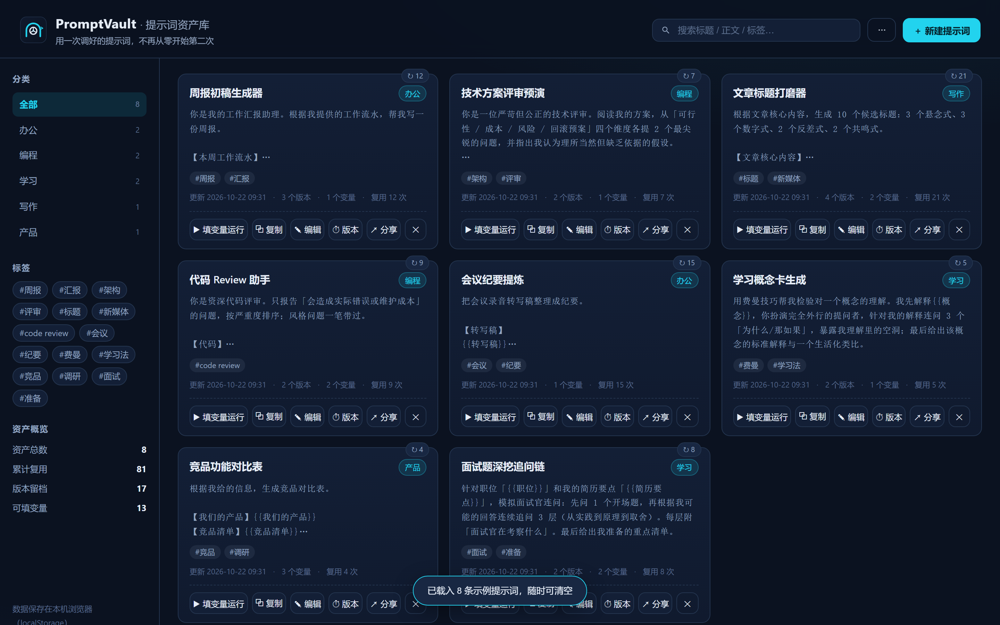
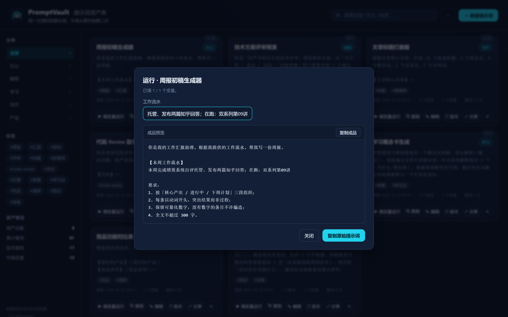
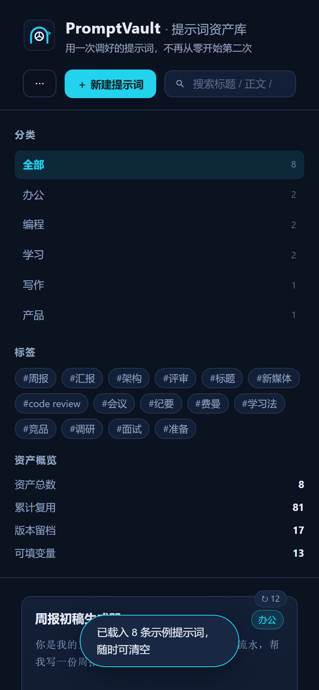

# PromptVault · 提示词资产库

<p align="center"></p>

> **用一次调好的提示词，不再从零开始第二次。**
> 提示词不是聊天记录里的尘埃，是越用越值钱的资产。

你肯定经历过：上周明明调好了一个提示词，效果很好——这周要用的时候，翻遍聊天记录找不到了。找到了，也忘了当时为什么那样写、改到第几版。我们把「资产」这个概念引入提示词管理：**一条提示词，只有能被检索、被复用、被版本化，才算资产。**

**PromptVault 把「存 → 找 → 用 → 迭代 → 分享」做成一个闭环**，浏览器里双击即用。

---

## ✦ 它能做什么

| 环节 | 功能 |
|---|---|
| **存** | 名称 + 分类 + 标签 + 正文；`{{变量}}` 占位符自动识别（如 `{{目标读者}}`），保存即入资产台账 |
| **找** | 全文检索（标题/正文/标签）+ 分类侧栏 + 标签云筛选，三秒定位 |
| **用** | 变量运行器：填好变量 → 实时预览成品 → 一键复制；原始提示词与成品分开复制，复用次数自动累计 |
| **迭代** | 每次保存自动留版本档（最多 30 版），版本历史一键回滚，回滚本身也留档 |
| **分享** | 提示词编码进链接，发给同事朋友，对方打开即见「收到一条分享」，一键存入他的资产库 |
| **备份** | 全量导出 / 导入 JSON，换机迁移零成本；内置 8 条示例提示词，一键载入体验 |

## ✦ 设计取舍（第一性原理）

- **无后端**：一条提示词的本质是一段文本，不需要服务器。全部存 localStorage——零成本、零运维、**数据不出浏览器**（对内容敏感的人，这点是底线）
- **URL 分享**：和「把留言编码进链接」同一个思路——分享不需要账号体系，只需要一个链接
- **版本即资产**：提示词的价值来自迭代。删掉迭代记录，等于烧掉资产的历史价格
- **变量而非模板引擎**：`{{变量}}` 填空覆盖 90% 的复用场景，不引入任何学习成本

## ✦ 快速开始

零依赖、零构建，双击即用：

```bash
# 方式一：直接打开
双击 index.html

# 方式二：本地静态服务
npx serve .
# 或
python -m http.server 8080
```

首次打开自动载入 8 条示例提示词（周报生成器、技术方案评审预演、标题打磨器……），可点「⋯ → 清空全部数据」一键清空。
试试核心闭环：任一条卡片点 **▶ 填变量运行** → 填好变量 → **复制成品**。

## ✦ 界面

<p align="center"></p>
<p align="center">　</p>

## ✦ 适用场景

- 天天和 AI 协作的开发者 / 运营 / 写作者：把「调好的提示词」沉淀成团队/个人资产
- 周报、纪要、评审、标题、竞品分析……高频场景各存一条变量化模板
- 想检验「我的提示词库值多少钱」：看复用次数和版本数，一目了然

## ✦ 技术实现

- 纯原生 HTML / CSS / JavaScript，单文件应用无框架依赖
- `localStorage` 持久化 + `URL hash` 编码分享 + `Clipboard API`（带 `execCommand` 兜底）
- 原生 `<dialog>` 模态、`datalist` 分类联想，无任何运行时依赖

---

MIT License · 由 AI 辅助创作的 vibecoding 作品
